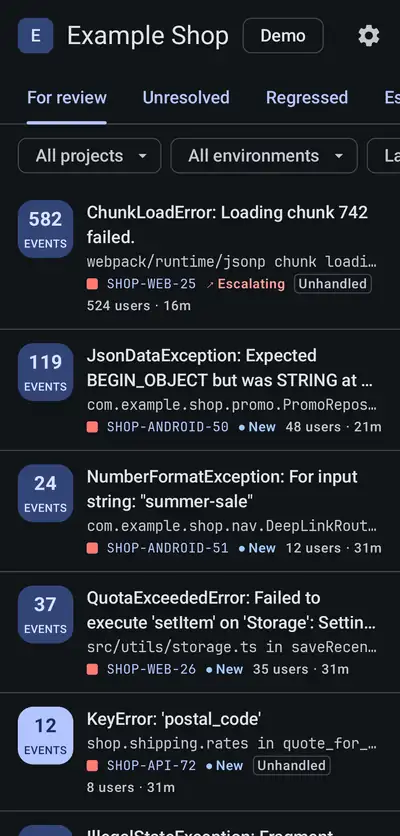
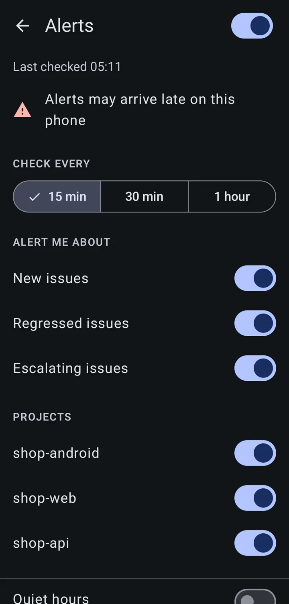

<div align="center">


# Triage

**An error inbox for your Sentry issues, on Android.**

Get told when something new, regressed or escalating shows up.<br>
Read the stack trace and resolve it with a swipe, before you're back at your desk.

[](https://github.com/sriharinmn/triage-android/releases/latest)
[](https://github.com/sriharinmn/triage-android/actions/workflows/ci.yml)
[](LICENSE)
[](#install)

<a href="https://github.com/sriharinmn/triage-android/releases/latest"></a>
&nbsp;
<a href="https://apps.obtainium.imranr.dev/redirect?r=obtainium://app/%7B%22id%22%3A%22io.github.sriharinmn.triage%22%2C%22url%22%3A%22https%3A%2F%2Fgithub.com%2Fsriharinmn%2Ftriage-android%22%2C%22author%22%3A%22sriharinmn%22%2C%22name%22%3A%22Triage%22%7D"></a>

[Website](https://sriharinmn.github.io/triage-android/) · [Features](#features) · [Install](#install) · [Privacy](#privacy) · [Build](#build-from-source)

&nbsp;
&nbsp;
&nbsp;


<sub>Screenshots use the built-in demo data: a made-up online shop.</sub>

</div>

## Features

- **An inbox, not a dashboard.** For review, Unresolved, Regressed and Escalating tabs, filters for project and environment, sorting, and pull to refresh.
- **Triage in a swipe.** Swipe right to resolve, left to archive. Assign to yourself or a teammate, or mark reviewed. Everything can be undone.
- **Stack traces made for a phone.** The latest event's trace with your app's frames highlighted and the lines around them, plus breadcrumbs, tags, stats and a 24-hour trend.
- **Alerts that respect your evening.** Background checks every 15, 30 or 60 minutes for new, regressed and escalating issues, per project. Quiet hours hold them until morning. Resolve or archive straight from the notification.
- **Works with your Sentry.** sentry.io (US and EU) and self-hosted.
- **Try it without an account.** Demo mode runs every screen, action and alert on a made-up shop's issues.
- Material You colors, and dark and light themes.

## Install

1. On your phone (Android 8.0 or newer), download [`triage.apk`](https://github.com/sriharinmn/triage-android/releases/latest/download/triage.apk) from the [latest release](https://github.com/sriharinmn/triage-android/releases/latest).
2. Open it. Android asks once to allow installs from your browser. Play Protect may not know the app yet: tap **More details → Install anyway**.
3. Connect with a Sentry token, or tap **Try with sample data**.

**Updates:** add this repository to [Obtainium](https://github.com/ImranR98/Obtainium) (or tap the badge above) and it will tell you about new releases.

**Verify your download:** each release lists the APK's SHA-256. Every release is signed with the same key, whose certificate SHA-256 is:

```
C7:8B:61:D4:F1:F6:F4:4F:DE:F9:3E:D0:DF:82:D5:1A:92:78:7C:E9:16:9F:E7:C1:D7:61:B9:38:BB:EB:8F:7D
```

### Connecting to Sentry

Triage asks for a [personal token](https://docs.sentry.io/account/auth-tokens/#personal-tokens). The app opens the right Sentry page for you. Give the token only these permissions:

| Permission | Access | Used for |
|---|---|---|
| Organization | Read | Finding your organization |
| Project | Read | Project filters and per-project alerts |
| Issue & Event | Read & Write | Issues, stack traces, and resolve, archive, assign |
| Member | Read | Choosing who to assign an issue to |

## Privacy

- Your phone talks only to the Sentry server you connect. There is no Triage server.
- No analytics, no ads, no crash-reporting SDK.
- Your token is encrypted on the phone with the Android Keystore, and app data is left out of cloud backups.

Read the full [privacy policy](https://sriharinmn.github.io/triage-android/privacy.html).

## Build from source

You need JDK 21 and the Android SDK. Gradle downloads everything else.

```bash
./gradlew assembleDebug        # debug APK (package io.github.sriharinmn.triage.debug)
./gradlew testDebugUnitTest    # unit tests
./gradlew lintDebug            # lint
```

`./gradlew assembleRelease` gives an unsigned release unless you set up your own signing key. Kotlin, Jetpack Compose, Material 3, Navigation 3, Room, DataStore, WorkManager and OkHttp, with no backend.

## Feedback and security

Bugs and ideas are welcome in [issues](https://github.com/sriharinmn/triage-android/issues). Please report security problems privately, as described in [SECURITY.md](SECURITY.md).

## License

Triage is licensed under the [Apache License 2.0](LICENSE) (see also [NOTICE](NOTICE)). It's made by [Srihari Kanakaraj](https://github.com/sriharinmn) · triagedev2026@gmail.com

<sub>Triage is not affiliated with or endorsed by Sentry / Functional Software, Inc. Sentry is a trademark of Functional Software, Inc.</sub>
