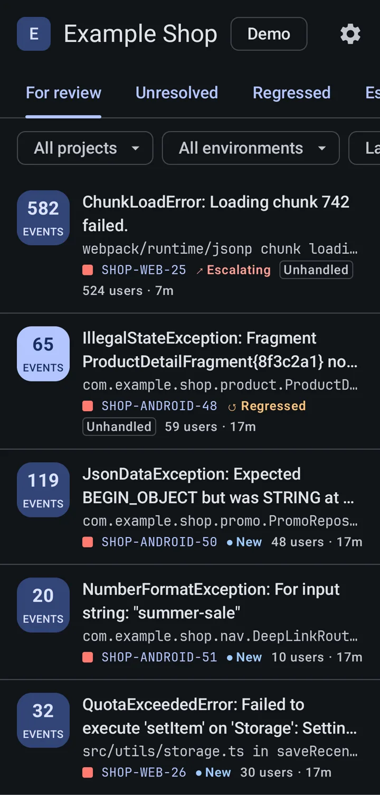
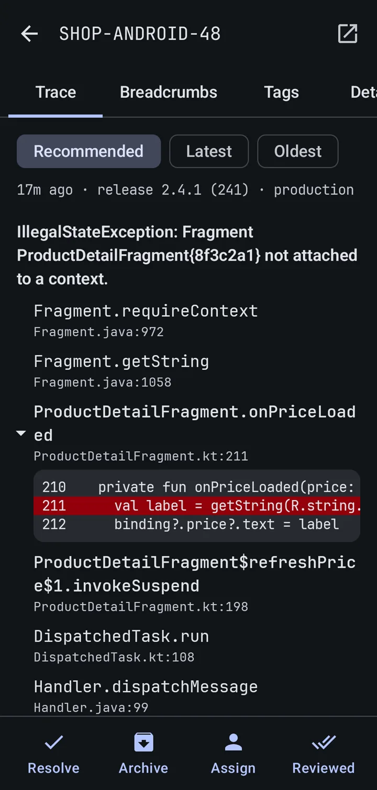
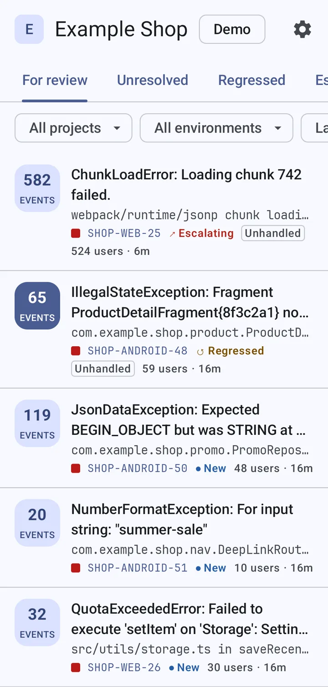

<p align="center"></p>

<h1 align="center">Triage</h1>

<p align="center"><b>Production broke. You'll know first.</b><br>
A fast, private error inbox for your Sentry issues, on Android.<br>
Free · Open source · No tracking</p>

<p align="center">
  <a href="https://github.com/sriharinmn/triage-android/releases/latest/download/triage.apk"><b>Download the APK</b></a> ·
  <a href="https://sriharinmn.github.io/triage-android/">Website</a> ·
  <a href="https://sriharinmn.github.io/triage-android/privacy.html">Privacy</a>
</p>

<p align="center">
  
  
  
</p>

## Features
- **Inbox:** For review, Unresolved, Regressed and Escalating, with project and environment filters and sorting.
- **Swipe actions:** right to resolve, left to archive, with undo; assign to yourself or a teammate; mark reviewed.
- **Issue detail:** stats, 24-hour trend, tags, the latest event's stack trace with in-app frames highlighted, breadcrumbs.
- **Alerts:** background checks every 15/30/60 min for new, regressed and escalating issues, per project, with quiet hours and Resolve/Archive on the notification.
- **sentry.io (US and EU) and self-hosted Sentry.**
- **Demo mode:** try everything with a made-up shop's issues, no account needed.
- Material You, dark mode.

## Install
Download [`triage.apk`](https://github.com/sriharinmn/triage-android/releases/latest/download/triage.apk) on your phone (Android 8 or newer) and open it. Android asks once to allow installs from your browser. Each [release](https://github.com/sriharinmn/triage-android/releases) lists the APK's SHA-256.

For automatic updates, add this repository to [Obtainium](https://github.com/ImranR98/Obtainium).

## Privacy
The app talks only to the Sentry server you choose. No Triage server, no analytics, no crash reporting. Your token is encrypted on the phone with the Android Keystore. Full policy: [privacy](https://sriharinmn.github.io/triage-android/privacy.html).

## Build from source
Needs JDK 21 and the Android SDK.

```bash
./gradlew assembleDebug        # app/build/outputs/apk/debug/app-debug.apk (package …triage.debug)
./gradlew testDebugUnitTest    # unit tests
```

`./gradlew assembleRelease` builds an unsigned release unless you configure your own signing key.

## Security
Please report security problems privately: see [SECURITY.md](SECURITY.md).

## License
Apache License 2.0, see [LICENSE](LICENSE) and [NOTICE](NOTICE). Made by [Srihari Kanakaraj](https://github.com/sriharinmn) · triagedev2026@gmail.com

Triage is not affiliated with Sentry / Functional Software, Inc.
